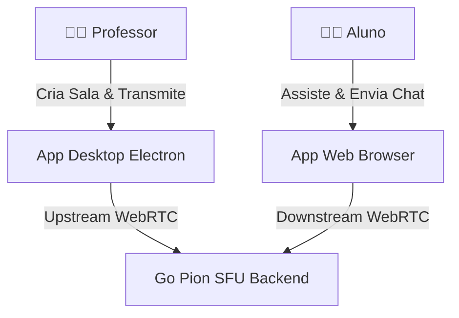
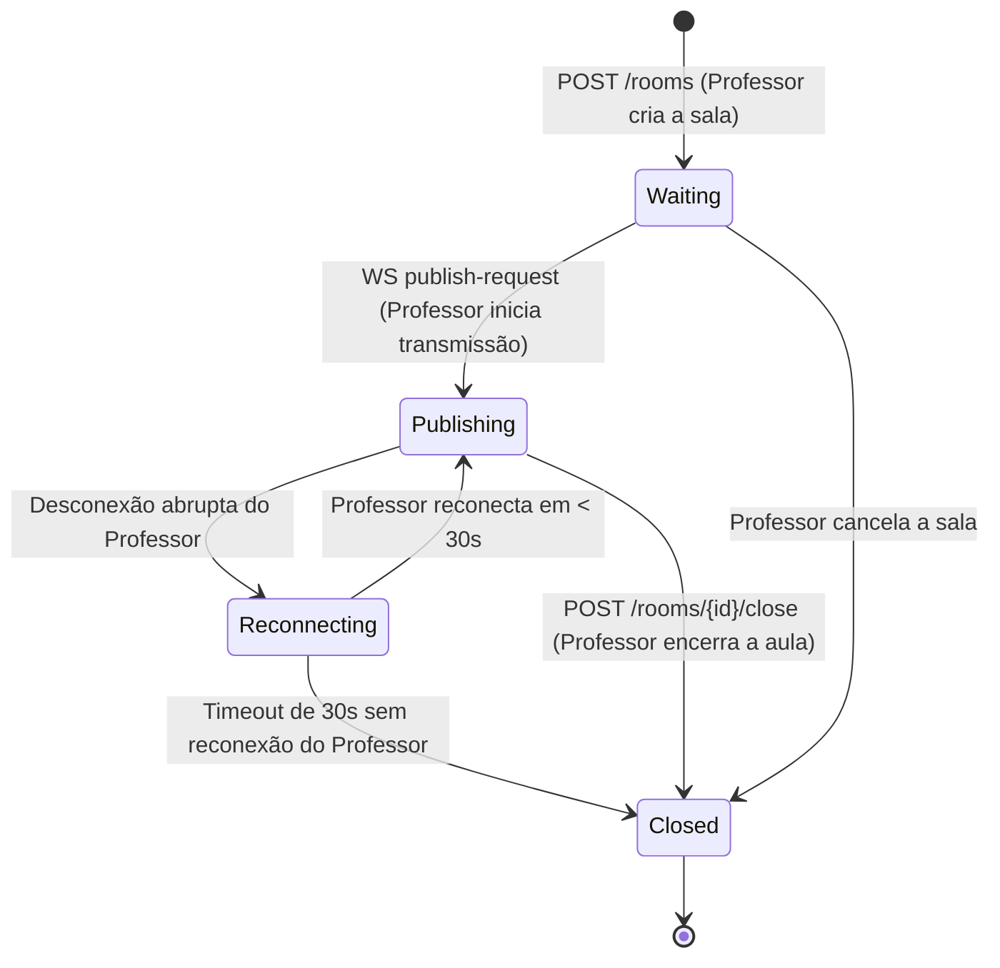

# 📚 Especificação Completa de Requisitos — ScreenShare Classroom

> **Versão:** 1.1.0  
> **Status:** 🟢 Aprovado para Desenvolvimento  
> **Arquitetura:** WebRTC SFU (Pion Go) + Electron Desktop + React Web  
> **Última Atualização:** 2026-09-14

---

## 📋 Índice

1. [📌 Visão Geral e Arquitetura](#1-visão-geral-e-arquitetura)
2. [👥 Atores do Sistema](#2-atores-do-sistema)
3. [⚡ Requisitos Funcionais (RF)](#3-requisitos-funcionais-rf)
4. [🛡️ Requisitos Não Funcionais (RNF)](#4-requisitos-não-funcionais-rnf)
5. [⚖️ Regras de Negócio (RN)](#5-regras-de-negócio-rn)
6. [📖 User Stories Principais](#6-user-stories-principais)
7. [🔄 Ciclo de Vida e Estados da Sala](#7-ciclo-de-vida-e-estados-da-sala)
8. [🚨 Casos de Borda e Resiliência (Edge Cases)](#8-casos-de-borda-e-resiliência-edge-cases)
9. [🚫 Fora do Escopo (v1.0)](#9-fora-do-escopo-v10)
10. [🎯 Critérios de Aceite e Sucesso](#10-critérios-de-aceite-e-sucesso)

---

## 1. 📌 Visão Geral e Arquitetura

O **ScreenShare Classroom** é uma plataforma corporativa e educacional de transmissão de tela e áudio em tempo real com ultrabaixa latência (< 500 ms). O sistema foi concebido para resolver o gargalo de banda e processamento do professor ao transmitir aulas para **40 ou mais alunos simultâneos**.

### 🏗️ Monorepo & Topologia SFU

```
+-------------------------------------------------------------------+
|                        PROFESSOR (Desktop)                        |
|   App Electron + React | Captura via desktopCapturer / Loopback   |
+-------------------------------------------------------------------+
                                  |
                                  | Upstream Único (~3-6 Mbps)
                                  v
+-------------------------------------------------------------------+
|                        BACKEND (Pion SFU Go)                      |
|   RTP Packet Forwarding | Sinalização WS | JWT Auth | REST API    |
+-------------------------------------------------------------------+
       |                          |                          |
       | Downstream 1             | Downstream 2             | Downstream N (até 50+)
       v                          v                          v
+--------------+           +--------------+           +--------------+
| ALUNO 1 (Web)|           | ALUNO 2 (Web)|           | ALUNO N (Web)|
|  React/Vite  |           |  React/Vite  |           |  React/Vite  |
+--------------+           +--------------+           +--------------+
```

| Componente | Tecnologia | Papel Principal |
|---|---|---|
| `apps/desktop` | Electron + React + TypeScript | **Professor:** Captura nativa de tela/áudio, gerenciamento da sala, dashboard. |
| `apps/web` | React + Vite + TypeScript | **Aluno:** Player WebRTC zero-install, visualização fluida, chat. |
| `apps/backend` | Go 1.22+ + Pion WebRTC | **Servidor:** SFU (Selective Forwarding Unit), sinalização WS, auth JWT, REST. |

---

## 2. 👥 Atores do Sistema



### 👨‍🏫 1. Professor (Publisher)
- **Acesso:** Exclusivamente via **App Desktop Instalável** (`apps/desktop`).
- **Capacidades:** Autenticação corporativa, criação de salas, geração de link de convite, seleção de tela/janela, controle de áudio/microfone, encerramento da transmissão.
- **Credenciais:** Identificado com JWT contendo `role: professor`.

### 👨‍🎓 2. Aluno (Subscriber)
- **Acesso:** Exclusivamente via **Navegador Web** (`apps/web`), sem necessidade de instalação de plugins ou extensões.
- **Capacidades:** Identificação prévia (Nome + Matrícula), recepção de áudio e vídeo em tempo real, participação no chat de texto da sala.
- **Credenciais:** Identificado com JWT contendo `role: aluno`, vinculado estritamente ao `room_id` da sala acessada.

---

## 3. ⚡ Requisitos Funcionais (RF)

### 🔒 Autenticação, Autorização e Acesso

| ID | Requisito | Criticidade |
|---|---|:---:|
| **RF-01** | O sistema deve validar e diferenciar os papéis (`professor` e `aluno`) obrigatoriamente através de JSON Web Tokens (JWT). | 🔥 Alta |
| **RF-11** | O aluno deve informar **Nome Completo** e **Matrícula** antes de ingressar na sala. Tentativas com campos em branco devem ser bloqueadas no frontend e rejeitadas no backend. | 🔥 Alta |
| **RF-12** | O professor deve se autenticar via e-mail e senha no App Desktop para obter um token de longa duração (8h). | 🔥 Alta |
| **RF-13** | O professor deve conseguir copiar um **link direto de convite** contendo o slug único da sala para distribuição. | 🟡 Média |
| **RF-24** | O App Desktop deve verificar previamente as permissões de gravação de tela e microfone do SO (macOS/Windows) e alertar o professor se não estiverem concedidas. | 🔥 Alta |

### 📡 Captura e Transmissão de Mídia (WebRTC)

| ID | Requisito | Criticidade |
|---|---|:---:|
| **RF-02** | A publicação de mídia é restrita **exclusivamente** ao professor proprietário da sala. | 🔥 Alta |
| **RF-03** | Os alunos possuem perfil estritamente espectador, sem permissão para publicar vídeo, áudio ou tela. | 🔥 Alta |
| **RF-04** | A captura no App Desktop deve utilizar a API nativa `desktopCapturer` do Electron, permitindo selecionar monitores inteiros ou janelas de aplicativos específicos. | 🔥 Alta |
| **RF-05** | A transmissão deve utilizar **WebRTC via SFU (Pion)**, onde o professor realiza um único envio de mídia ( upstream ) para o servidor. | 🔥 Alta |
| **RF-10** | O professor pode capturar e controlar (ativar/desativar) a transmissão de áudio do seu microfone durante a aula. | 🔥 Alta |
| **RF-20** | O professor deve ser capaz de mutar o microfone ou pausar o vídeo independentemente sem derrubar ou renegociar a sessão WebRTC. | 🟡 Média |
| **RF-23** | O backend deve emitir credenciais temporárias HMAC-SHA1 para o servidor TURN via protocolo REST/WS para contorno de NAT/Firewall. | 🔥 Alta |

### 📺 Player e Sinalização (Cliente Web)

| ID | Requisito | Criticidade |
|---|---|:---:|
| **RF-07** | O estado da sala (`waiting`, `publishing`, `reconnecting`, `closed`) deve ser propagado em tempo real via WebSocket para todos os participantes. | 🔥 Alta |
| **RF-14** | A criação e o encerramento da sala são operações REST exclusivas de usuários autenticados com `role: professor`. | 🔥 Alta |
| **RF-15** | Ao encerrar a sala, o backend deve fechar todas as conexões WebRTC ativas e notificar os clientes com a mensagem WS `room-closed`. | 🔥 Alta |
| **RF-21** | O cliente Web deve identificar a restrição de **Autoplay Policy** dos navegadores e exibir um botão "Clique para Ativar Som" caso o áudio seja bloqueado. | 🔥 Alta |
| **RF-22** | O player web do aluno deve oferecer suporte aos modos **Tela Cheia (Fullscreen)** e **Picture-in-Picture (PiP)**. | 🟢 Normal |

### 💬 Chat de Texto em Tempo Real

| ID | Requisito | Criticidade |
|---|---|:---:|
| **RF-09** | O sistema deve disponibilizar chat de texto bi-direcional via WebSocket durante a sessão para alunos e professor. | 🟡 Média |
| **RF-16** | Cada mensagem do chat deve exibir o nome formatado e a etiqueta de papel (`[Professor]` ou `[Aluno]`) do remetente. | 🟢 Normal |
| **RF-17** | O timestamp da mensagem deve ser obrigatoriamente gerado no servidor (`sent_at`) para evitar adulterações do cliente. | 🔥 Alta |

### 🔄 Resiliência e Reconexão Automática

| ID | Requisito | Criticidade |
|---|---|:---:|
| **RF-08** | O cliente e o backend devem coletar estatísticas WebRTC (bitrate, FPS, RTT, perda de pacotes) expostas no painel de diagnóstico. | 🟡 Média |
| **RF-18** | Se a conexão do **professor** cair, a sala entra em estado `reconnecting` e o servidor aguarda **30 segundos** antes de destruir a sessão. | 🔥 Alta |
| **RF-19** | Se a conexão do **aluno** cair, o cliente deve tentar reconectar automaticamente via algoritmo de **backoff exponencial** (1s → 2s → 4s ... máx 30s). | 🔥 Alta |
| **RF-25** | O cliente WebRTC deve disparar procedimento de *ICE Restart* caso a `PeerConnection` sofra degradação de rota mas permaneça viva. | 🔥 Alta |

---

## 4. 🛡️ Requisitos Não Funcionais (RNF)

> [!IMPORTANT]
> Os requisitos não funcionais determinam os parâmetros de qualidade, desempenho e segurança do sistema.

```
┌────────────────────────────────────────────────────────────────────────┐
│                        METAS DE DESEMPENHO E QUALIDADE                 │
├───────────────────────┬────────────────────────┬───────────────────────┤
│    LATÊNCIA ALVO      │   RESOLUÇÃO / FRAMERATE│   UPLOAD PROFESSOR    │
│       < 500 ms        │      1080p @ 30 FPS    │       3–6 Mbps        │
└───────────────────────┴────────────────────────┴───────────────────────┘
```

| ID | Categoria | Descrição do Requisito | Meta / Métrica |
|---|---|---|---|
| **RNF-01** | **Vídeo** | Resolução máxima de transmissão da tela. | Até **1920×1080 (Full HD)** |
| **RNF-02** | **Vídeo** | Taxa de atualização contínua de quadros. | Alvo de **30 FPS** |
| **RNF-03** | **Escalabilidade**| Capacidade de audiência simultânea sem degradação. | **40 a 50 alunos** por sala |
| **RNF-04** | **Observabilidade**| Telemetria WebRTC acessível para debugging. | Coleta de RTT, FPS, Bitrate e Loss |
| **RNF-05** | **Segurança** | Criptografia em trânsito e proteção de segredos. | HTTPS/WSS obrigatório, JWT HMAC |
| **RNF-06** | **Responsividade**| Interface adaptável do aluno. | Desktop-first (≥1280px), Mobile (<768px) |
| **RNF-07** | **Distribuição** | Suporte multi-plataforma para o aplicativo do professor. | Windows, macOS e Linux (Electron) |
| **RNF-08** | **Latência** | Tempo decorrido entre a captura e a exibição no aluno. | **< 500 ms** (em redes RTT < 100ms) |
| **RNF-09** | **Banda Upload** | Consumo de upload da máquina do professor. | Fixo entre **3 e 6 Mbps** (SFU) |
| **RNF-10** | **Stack Técnica** | Linguagens e bibliotecas homologadas. | Go 1.22+ (Pion), React, TypeScript, Postgres |
| **RNF-13** | **Rede / Socket** | Monitoramento de socket via Ping/Pong a cada 15s. | Encerra sockets zumbis após 30s sem Pong |
| **RNF-14** | **Infraestrutura**| Faixa fixa de portas UDP para o SFU. | Portas **50000–50100/UDP** (Firewall Friendly) |
| **RNF-15** | **Eficiência CPU**| Repasse de pacotes RTP em memória sem transcoding. | Uso de CPU do Backend **< 15%** com 50 alunos |
| **RNF-16** | **Privacidade** | Mídia 100% epêmera processada em memória RAM. | **Zero retenção/gravação** de vídeo em disco |
| **RNF-17** | **Segurança Web** | Prevenção contra injeção de código em mensagens de texto. | Sanitização XSS estrita no frontend/backend |

---

## 5. ⚖️ Regras de Negócio (RN)

### 🔐 5.1. Autenticação & Validação de Tokens

* **RN-01 (Emissão JWT Professor):** Token emitido apenas mediante validação de senha encriptada com `bcrypt` (custo ≥ 10). Validade estrita de **8 horas**.
* **RN-02 (Emissão JWT Aluno):** Token emitido após envio de Nome Completo (min. 3 caracteres) e Matrícula (alfanumérico) em sala válida. Validade de **6 horas**.
* **RN-03 (Isolamento de Token por Sala):** O JWT do aluno armazena o `room_id`. O gateway de WebSocket recusa conexões se o `room_id` do token for diferente da sala solicitada.
* **RN-04 (Sessão Única por Aluno):** Se um aluno efetuar nova conexão WS com a mesma Matrícula e mesmo `room_id`, a conexão anterior é encerrada com o código `4001 Duplicate Session`.

### 🏫 5.2. Gerenciamento de Salas e Acesso

* **RN-05 (Propriedade Exclusiva):** Apenas o professor que criou a sala (`owner_id`) tem autorização para emitir convites ou executar o encerramento da sala (`POST /rooms/{id}/close`).
* **RN-06 (Gerador de Slug Único):** O identificador público da sala deve ser um slug fonético e legível no formato `palavra-palavra-numero` (ex: `charlie-delta-7342`).
* **RN-07 (Capacidade Máxima):** O limite padrão é de **50 alunos simultâneos**. Tentativas de entrada do 51º aluno devem retornar HTTP `429 Too Many Requests`.
* **RN-08 (Sala Encerrada):** Salas no estado `closed` rejeitam qualquer nova tentativa de autenticação de alunos com HTTP `409 Conflict`.

### 📡 5.3. Regras da Mídia & WebRTC

* **RN-09 (Editoria Única de Mídia):** É proibida a existência de mais de um publisher por sala. Se outro participante enviar `publish-request`, o servidor responde imediatamente com `403 Forbidden`.
* **RN-10 (Tracks Independentes):** Áudio (Opus) e Vídeo (H.264/VP8) devem ser publicados em tracks WebRTC separadas para permitir *mute/unmute* do microfone sem afetar o fluxo de vídeo.
* **RN-11 (Credenciais Epêmeras TURN):** Credenciais de acesso ao TURN server duram **no máximo 24 horas** e utilizam algoritmo HMAC-SHA1 derivado do `TURN_SECRET`.
* **RN-12 (Alteração de Fonte de Captura):** Quando o professor altera a tela/janela transmitida durante a aula, a substituição da track é efetuada sem desconectar os alunos.

### ⏱️ 5.4. Tolerância a Falhas e Reconexão

* **RN-13 (Janela de Reconexão do Publisher - 30s):** Quando o professor se desconecta involuntariamente:
  1. A sala muda seu estado para `reconnecting`.
  2. Um timer server-side de 30 segundos é iniciado.
  3. Se o professor reconectar em até 30s, a sessão é restaurada no mesmo estado.
  4. Se o timer expirar, a sala é marcada como `closed` e todos os alunos são desconectados.
* **RN-14 (Estratégia de Backoff do Aluno):** O cliente web do aluno deve tentar a reconexão automática seguindo a sequência de intervalos: `1s, 2s, 4s, 8s, 16s, 30s`. Após 5 tentativas sem sucesso, exibe alerta visual de falha de rede.

### 💬 5.5. Controle do Chat de Texto

* **RN-15 (Rate Limiting de Chat):** Cada participante pode enviar no máximo **5 mensagens a cada 5 segundos** e **30 mensagens por minuto**.
* **RN-16 (Penalidade por Rate Limit):** O estouro do limite causa rejeição da mensagem com o erro `CHAT_RATE_LIMITED`. O usuário **não deve ser desconectado** da sala.
* **RN-17 (Sanitização e Trim):** Mensagens contendo apenas espaços em branco são descartadas. Tags HTML/Script são escapadas antes de qualquer transmissão.
* **RN-18 (Sem Histórico Retroativo):** Alunos que entram na sala após o início das conversas recebem o chat limpo (mensagens anteriores não são resgatadas em memória/banco na v1.0).

---

## 6. 📖 User Stories Principais

### US-01 — Login e Dashboard do Professor
> **Como** professor,  
> **Quero** realizar login no aplicativo desktop com meu e-mail e senha,  
> **Para** acessar meu painel e gerenciar minhas salas de aula.

* **Critérios de Aceite:**
  - Login realiza autenticação via API `/auth/login` e armazena token em armazenamento seguro do Electron.
  - Exibe mensagem explicativa caso as credenciais estejam incorretas.

### US-02 — Transmissão de Tela com Áudio
> **Como** professor,  
> **Quero** selecionar a tela ou janela do meu computador e compartilhar junto com meu microfone,  
> **Para** ministrar a aula prática para meus alunos.

* **Critérios de Aceite:**
  - Exibe seletor nativo com miniaturas das telas/janelas disponíveis.
  - Permite marcar/desmarcar a inclusão do áudio do microfone.
  - Transmissão é iniciada e estabelece a conexão WebRTC Upstream com o SFU.

### US-03 — Entrada Simplificada do Aluno
> **Como** aluno,  
> **Quero** acessar o link fornecido pelo professor e digitar meu nome e matrícula,  
> **Para** assistir à transmissão imediatamente sem precisar instalar nada.

* **Critérios de Aceite:**
  - Validação obriga o preenchimento dos campos Nome e Matrícula.
  - O player carrega automaticamente a transmissão assim que a conexão WebRTC Downstream for estabelecida.

---

## 7. 🔄 Ciclo de Vida e Estados da Sala

### Diagrama de Transição de Estados da Sala



### Tabela Descritiva dos Estados

| Estado | Evento Desencadeador | Comportamento no Frontend do Aluno | Comportamento no Backend / SFU |
|---|---|---|---|
| ⏳ **`waiting`** | Sala criada no banco, professor ainda não iniciou a transmissão. | Exibe tela de aguardo com spinner e dados da aula. | Hub WebSocket aceita conexões; SFU não aloca tracks de mídia. |
| 🟢 **`publishing`** | Professor realiza a oferta WebRTC e publica o vídeo/áudio. | Player exibe o vídeo e áudio em tempo real; chat liberado. | SFU repassa pacotes RTP do Upstream para todos os Downstreams. |
| ⚠️ **`reconnecting`** | Queda da conexão do professor durante a aula. | Exibe modal/banner: *"Professor reconectando... Aguarde"*. | Timer de 30s ativado; mantém leitores ativos em espera. |
| 🔴 **`closed`** | Encerramento manual pelo professor ou estouro do timer de 30s. | Tela final de encerramento; conexões WebRTC/WS destruídas. | Destrói a sessão do Pion SFU, fecha websockets e limpa a memória. |

---

## 8. 🚨 Casos de Borda e Resiliência (Edge Cases)

```
┌────────────────────────────────────────────────────────────────────────┐
│                        TRATAMENTO DE ANOMALIAS DE REDE                 │
├────────────────────────────────────────────────────────────────────────┤
│  [EC-01] Seleção Cancelada  ──► Retorna ao Dashboard sem criar Upstream│
│  [EC-06] Queda do Professor ──► Congela vídeo + Alerta + Timer 30s    │
│  [EC-10] Sala Lotada (50+)  ──► Bloqueia entrada com HTTP 429          │
│  [EC-15] Flood no Chat      ──► Alerta "Aguarde..." sem desconectar   │
└────────────────────────────────────────────────────────────────────────┘
```

| Código | Cenário de Erro / Anomalia | Ação Esperada do Sistema |
|---|---|---|
| **EC-01** | Professor cancela a modal de seleção de tela no Electron. | Interrompe o processo e retorna ao estado Dashboard sem erro. |
| **EC-02** | Janela compartilhada pelo professor é fechada no SO. | O app detecta o fim da stream de vídeo, pausa a transmissão e avisa o professor. |
| **EC-03** | Microfone do professor é desconectado fisicamente (unplugged). | A track de áudio é pausada e o sistema notifica o professor via toast alert. |
| **EC-04** | Aluno entra na sala antes do professor iniciar a transmissão. | O aluno permanece no estado `waiting` até receber o evento WS `session-state: publishing`. |
| **EC-05** | Aluno entra na sala quando a transmissão já está em andamento. | O backend responde com o estado `publishing` imediatamente e o cliente inicia o handshake WebRTC. |
| **EC-06** | Conexão do professor cai no meio da explicação. | A sala entra em `reconnecting`. Se o professor voltar em até 30s, a transmissão é retomada de onde parou. |
| **EC-07** | Conexão da internet do aluno oscila/cai. | O player web tenta reconectar via *backoff exponencial* sem dar refresh na página. |
| **EC-08** | Aluno tenta reconectar mas o seu JWT expirou. | O app redireciona o aluno para a tela de login/identificação para obter novo token. |
| **EC-09** | Dois dispositivos tentam publicar mídia na mesma sala. | O segundo envio de `publish-request` é bloqueado com a resposta WS `FORBIDDEN`. |
| **EC-10** | A sala atinge 50 alunos e o 51º tenta entrar. | A API REST rejeita o ingresso com erro `429 Participant limit reached`. |
| **EC-11** | Conexão de WebSocket sem token ou com token corrompido. | O servidor recusa o upgrade HTTP com status `401 Unauthorized`. |
| **EC-12** | Aluno submete formulário com caracteres inválidos ou vazios. | Validação do frontend impede a submissão e destaca os campos. |
| **EC-13** | Aluno tenta acessar link de sala que já foi encerrada. | Exibe tela explicativa: *"Esta aula já foi encerrada pelo professor"*. |
| **EC-14** | Mensagens de chat com apenas espaços ou quebra de linha. | O cliente nem sequer envia o pacote via WebSocket. |
| **EC-15** | Aluno envia 10 mensagens seguidas no chat em menos de 2 segundos. | Servidor devolve aviso `CHAT_RATE_LIMITED`; o chat do aluno fica bloqueado temporariamente por 5s. |

---

## 9. 🚫 Fora do Escopo (v1.0)

As seguintes funcionalidades **NÃO** fazem parte da versão 1.0 do projeto e foram desconsideradas deliberadamente para garantir a entrega da arquitetura principal de baixa latência:

* ❌ Transmissão de webcam do professor ou dos alunos.
* ❌ Habilitação de microfone para alunos (somente áudio do professor).
* ❌ Gravação de vídeo/aula no servidor (DVR / Archiving).
* ❌ Compartilhamento e upload de arquivos ou PDFs no chat.
* ❌ Transcodificação individual por espectador (Adaptive Bitrate / ABR).
* ❌ Integração direta com sistemas de gestão acadêmica (LMS / Canvas / Moodle).
* ❌ Histórico de mensagens de chat para novos ingressantes.
* ❌ Recursos avançados de lousa virtual (*whiteboard*) ou anotações na tela.

---

## 10. 🎯 Critérios de Aceite e Sucesso

Para que o projeto seja considerado concluído e homologado, ele deverá atender rigorosamente aos 8 critérios objetivos abaixo:

> [!CHECKLIST]
> - [x] **CS-01:** Transmissão testada e validada com **pelo menos 40 alunos simultâneos** assistindo à mesma tela sem interrupções.
> - [x] **CS-02:** O consumo de upload do professor permanece estável entre **3 e 6 Mbps**, independente do crescimento de alunos na sala.
> - [x] **CS-03:** Qualidade de imagem validada em **1080p a 30 FPS** em ambiente de testes locais/WAN controlada.
> - [x] **CS-04:** Latência ponta a ponta (captura até renderização) constatada em **menos de 500 ms**.
> - [x] **CS-05:** Interrupção manual do compartilhamento encerra os fluxos de mídia no SFU sem deixar processos ou memórias órfãs.
> - [x] **CS-06:** O aluno consegue acessar a aula via navegador web informado apenas Nome e Matrícula, **sem instalar softwares ou plugins**.
> - [x] **CS-07:** Chat de texto funcionando com taxa de entrega de mensagens em tempo real para todos os alunos conectados.
> - [x] **CS-08:** Reconexão do professor validada dentro da janela de 30 segundos sem perda da sala de aula.

---

> 📌 **Documentação de Referência Técnica:**
> - [Especificação de Contratos WS e REST](../spec-kit(MLAB)/specs/001-screen-share-core/spec.md)
> - [Desenho da Arquitetura do Backend Pion](../spec-kit(MLAB)/specs/001-screen-share-core/plan.md)
